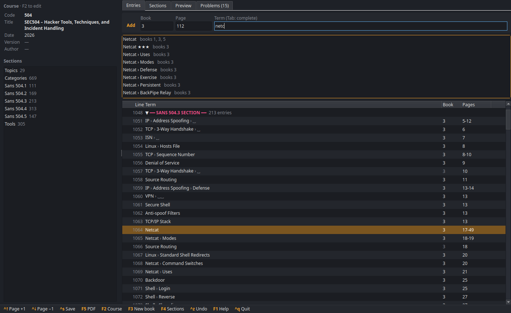
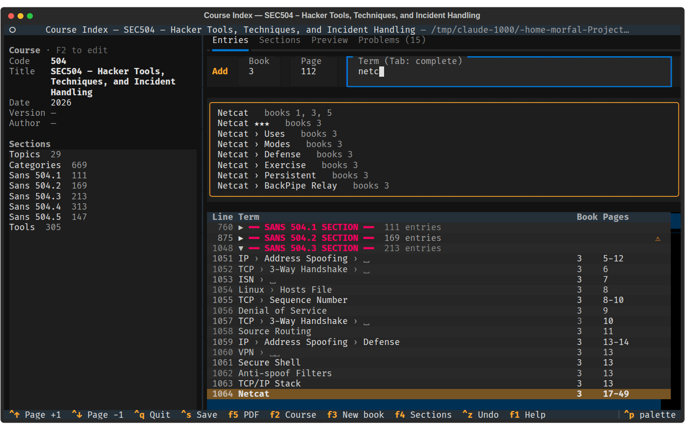

<p align="center"></p>
<h1 align="center" id="top">Course Index <a href="https://twitter.com/intent/tweet?text=Course%20Index%20-%20A%20GUI%20and%20TUI%20for%20editing%20the%20index%20of%20your%20course%20with%20the%20LaTeX%20course%20index%20template%20and%20compiling%20it%20to%20PDF.%0D%0Ahttps%3a%2f%2fgithub%2ecom%2facademic-templates%2fcourse-index%0D%0A&hashtags=python,latex,qt,tui,SANSrocks,GIAC"></a></h1>
<h3 align="center">Make the index of your course in a window or in the terminal, compile it to PDF.</h3>

[](https://pypi.python.org/pypi/course-index/)
[](https://pypi.python.org/pypi/course-index/)
[](https://github.com/dhondta/course-index/actions/workflows/python-package.yml)
[](https://github.com/dhondta/course-index/actions/workflows/security.yml)
[](#)
[](https://pypi.python.org/pypi/course-index/)

Course Index is a desktop application (with a terminal version) for editing the `.idx` file of the [LaTeX Course Index Template](https://github.com/academic-templates/tex-course-index-template), the condensed two-column indexes made for courses with several books (e.g. SANS courses, see the [examples](https://github.com/academic-templates/tex-course-index-template/tree/main/examples/sans)).

Instead of editing `\indexentry{...}` lines by hand, type the term, the book and the page: the template's conventions (`|book{N}`, a new line for each additional book, sort keys, sections, ...) are applied for you, the index is checked while you type, and `F5` compiles the PDF.

```sh
$ pip install course-index
$ course-index sec504.idx
```

<p align="center"></p>

The same editor runs in the terminal with `--tui` (and starts there by itself when no graphical session is available):

<p align="center"></p>

## :sunglasses: Features

- **Quick-add bar**: book, page, term, *Enter*. The book and page stay for the next term; `Ctrl+↑`/`Ctrl+↓` turn the page.
- **Sections as collapsible blocks** of lines; new entries go straight to the block of their book.
- **Validated input**: the book must exist (`F3` creates one), the page cannot be 0 and a range must end after it starts.
- **Sections and books** (*Sections* tab, `F4`): rename, add, delete and move the sections, set or change the book of a section and renumber its entries, rename the title of a book (the bold title of its parts in the *Topics*).
- **Suggestions** of the existing terms while typing (`Tab` completes), so that the pages of a term land on the same line of the index.
- **Template conventions applied automatically**: book number on the first page of a term in a book, a `term! ` line for each additional book, sort keys for terms starting with a command (`\texttt{.htaccess}` → `Htaccess@...`), new entries placed next to their group (Topics/Categories) or in their book's section.
- **Shortcuts**: `` `nc` `` → `\texttt{nc}`, `**x**` → `\textbf{x}`, `:linux:` → `\linux`, `_ & % #` escaped.
- **Structured editor** of an entry (levels, sort keys, book, pages, icons, rating) synchronized with its raw `\indexentry` line.
- **Preview** of the index as it will be typeset, **checks** (missing book, duplicates, book number not on the first page, unknown commands, malformed lines), **filter** (`book:2 page:45 netcat`).
- **Blank lines, page breaks and cross-references** in one key, **undo/redo**, comment out (`%`), move lines.
- **Lossless**: comments, sections and formatting of the file are kept; unchanged lines are written back as they were.
- **PDF compilation** with `makeindex` and `pdflatex` (`F5`), with the bundled template when the index is not in a template folder.

## :rocket: Usage

```sh
$ course-index                    # edit ./main.idx (created if missing)
$ course-index sec504.idx --tui   # edit it in the terminal instead of a window
$ course-index --init mycourse/   # copy the template (main.tex, data.tex, lib/) and start a new index
$ course-index sec504.idx --pdf   # compile sec504.pdf without opening the editor
$ course-index sec504.idx --check # list the problems of the index
```

| Key | Action |
|---|---|
| `a` | add references (quick-add bar) |
| `Enter` / `e`, `n` | edit the entry, new entry |
| `d`, `c`, `Space` | delete, duplicate, comment out |
| `b`, `p`, `x` | blank line, page break, cross-reference |
| `→` / `←`, `+` / `-` | expand / collapse the section, all the sections |
| `/` | filter |
| `Ctrl+S`, `F5` | save, compile the PDF |
| `F2` | course metadata (code, title, date, version, author), shown in the sidebar |
| `F3` | new book |
| `F4` | *Sections* tab (sections and their books) |
| `Ctrl+Z` / `Ctrl+Y` | undo / redo |
| `F1` | help |

Compiling requires a TeX distribution providing `makeindex` and `pdflatex`, with the packages used by the template (e.g. `texlive-latex-extra` on Debian/Ubuntu).

## :clap: Credits

The bundled LaTeX template comes from the [LaTeX Course Index Template](https://github.com/academic-templates/tex-course-index-template) (CC BY 4.0).

<p align="center"><a href="#top"></a></p>
