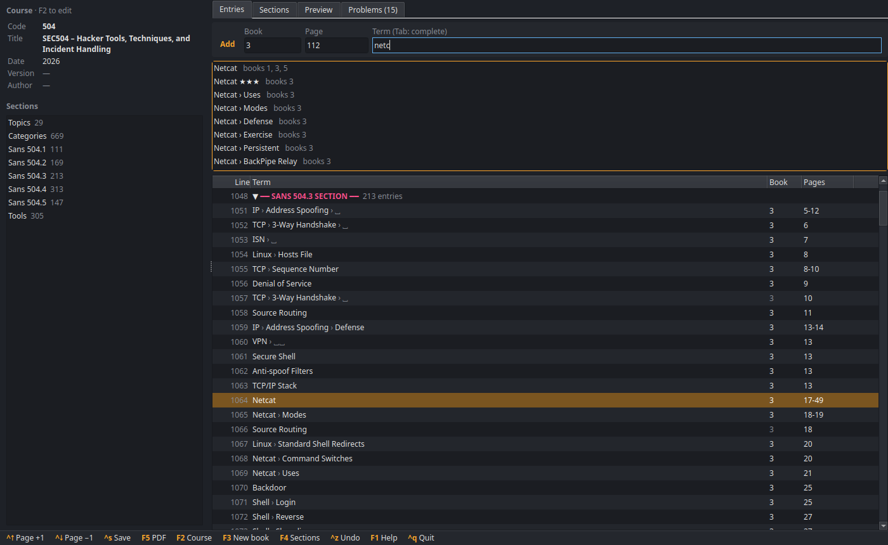
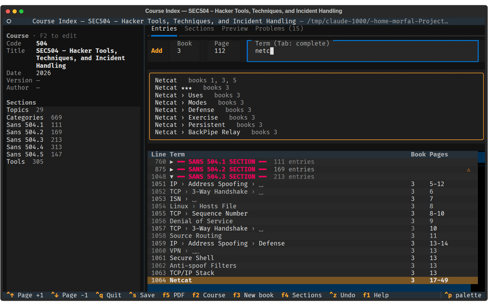

# Course Index

[](https://pypi.python.org/pypi/course-index/)
[](https://pypi.python.org/pypi/course-index/)
[](https://github.com/dhondta/course-index/actions/workflows/python-package.yml)
[](https://github.com/dhondta/course-index/actions/workflows/security.yml)
[](https://pypi.python.org/pypi/course-index/)

Course Index is a desktop application (with a terminal version, `--tui`) for making the index of a course with the
[LaTeX Course Index Template](https://github.com/academic-templates/tex-course-index-template): the condensed,
two-column indexes made for courses with several books, such as the
[SANS course indexes](https://github.com/academic-templates/tex-course-index-template/tree/main/examples/sans).

The template's index lives in a `.idx` file of `\indexentry{...}{...}` lines, each with a sort key, levels, a book
and a page. Writing them by hand means remembering the conventions of the template: `|book{2}` on the first page of a
term in a book only, a `term! ` line for each additional book, a sort key for terms starting with a command, the
section where the line goes, ... Course Index applies them for you: type the book, the page and the term, press
*Enter*, and go on with the next term.



The same editor runs in the terminal with `--tui`:



## Features

- **Quick-add bar**: the book and page stay for the next term, `Ctrl+↑`/`Ctrl+↓` turn the page.
- **Sections as collapsible blocks** of lines; new entries go straight to the block of their book.
- **Suggestions** of the existing terms while typing; completing one keeps its exact key, so that its pages merge on
  the same line of the index.
- **Template conventions applied automatically** (see [The .idx format](format.md)).
- **Input shortcuts**: `` `nc` `` → `\texttt{nc}`, `**x**` → `\textbf{x}`, `*x*` → `\textit{x}`, `:linux:` →
  `\linux`; `_ & % #` are escaped.
- **Structured editor** of an entry, synchronized with its raw `\indexentry` line.
- **Preview** of the index as it will be typeset, **checks** while you type, **filter**.
- **Blank lines, page breaks and cross-references** in one key, **undo/redo**.
- **Lossless editing**: comments, sections and the formatting of the file are kept.
- **PDF compilation** with `makeindex` and `pdflatex` in one key (`F5`).

## Quick start

```console
$ pip install course-index
$ course-index --init mycourse/    # new index, with a copy of the template
$ course-index sec504.idx          # or an existing index
```

Then press `F2` to set the course code and title, `F3` to create the books, `a` to add references and `F5` to
compile the PDF.
