# Usage

```console
$ course-index [FILE.idx]
```

Without argument, `main.idx` in the current folder is edited (it is created from a skeleton when saving if it does
not exist yet). See [Command line](cli/course-index.md) for the options.

The index is edited in a window; `--tui` edits it in the terminal instead (it also starts when no graphical session
is available). Both have the same layout and the same keys, described below, and the window adds the mouse: the
footer keys and the carets of the sections can be clicked, a double click edits a line.

The window holds:

- the **sidebar**: the **course** metadata (code, title, date, version and author, read-only: `F2` edits them) and the
  **sections** of the file (select one to jump to it; selecting a book section also sets the book of the quick-add bar);
- four **tabs**:
    - *Entries*: the **quick-add bar** (book, page, term) at the top, then the lines of the file;
    - *Sections*: the sections of the file and their books;
    - *Preview*: the index as it will be typeset;
    - *Problems*: the checks.

## Adding references

The quick-add bar, at the top of the *Entries* tab, is made for indexing a book page after page:

1. Press `a` (or click the bar), set the **book** (`1`, `2`, ..., `W` for a workbook) and the **page** (`45` or a
   range `45-47`).
2. Type the **term** and press **Enter**. The term is cleared; the book and the page stay for the next term.
3. Turn the page with `Ctrl+↑` / `Ctrl+↓` (or `PageUp` / `PageDown`).

`Enter` on the book field goes to the page field, and `Enter` on the page field goes to the term field.

### Books and pages

The book must be one of the books of the index, i.e. a book with a section in the file or used by an entry. Press
**F3** to create a new book: it suggests the next number (or type letters, e.g. `W` for a workbook) and creates its
section (`FIFTH BOOK SECTION`, `WORKBOOK SECTION`, ...) in book order. A new index has no book yet: create the first
one with `F3`. To rename a book's section, change its book or turn another section into a book, see
[Sections and books](#sections-and-books).

The page is a number or a range: it cannot be 0, and a range must end after it starts (`45-47`, not `47-45` nor
`45-45`).

The book and page fields turn red as soon as their value is invalid, and the reference is not added until they are
fixed.

Sub-levels are separated by `!`, as in the `.idx` syntax: `Netcat!Relays`. A sort key can be given with `@`:
`Htaccess@\texttt{.htaccess}`.

### Suggestions

From two characters on, the existing terms matching what you type are listed right below the bar (all the words must
match, in any order) with the books they appear in. Use `↑`/`↓` to choose one and `Tab` (or `Enter`) to complete it. Completing a
term keeps its exact key (e.g. `200@\textbf{Tools}!Netcat`), so that the new page is added to the same line of the
index instead of creating a new term that only looks the same. You can then type `!` and a sub-term.

### What happens when you press Enter

The reference is added following the conventions of the template (see [The .idx format](format.md)):

| Situation | Line added |
|---|---|
| new term | `\indexentry{Term\|book{2}}{45}` |
| term already in book 2, later page | `\indexentry{Term}{45}` (the book number is only on the first page) |
| term already in book 2, earlier page | `\indexentry{Term\|book{2}}{45}`, and the book number is removed from the other page |
| term already in another book | `\indexentry{Term! \|book{2}}{45}` (a new line under the term for this book) |
| term starting with a command | `\indexentry{Htaccess@\texttt{.htaccess}\|book{2}}{45}` (sort key added) |

The new line goes:

- right after the other lines of its group when the term belongs to the *Topics* or *Categories* (e.g. after the last
  `200@\textbf{Tools}!...` line);
- at the end of the *Topics* or *Categories* section for a new topic or category;
- otherwise at the end of the section of its book, which is created (in book order, before the cross-keys) if needed.

### Input shortcuts

| Typed | Written |
|---|---|
| `` `nc -l` `` | `\texttt{nc -l}` |
| `**Important**` | `\textbf{Important}` |
| `*emphasis*` | `\textit{emphasis}` |
| `:linux:`, `:win:`, `:python:`, ... | `\linux`, `\win`, `\python`, ... |
| `_`, `&`, `%`, `#` | `\_`, `\&`, `\%`, `\#` |

The shortcuts are only expanded in what you type, never in existing LaTeX.

## The entries table

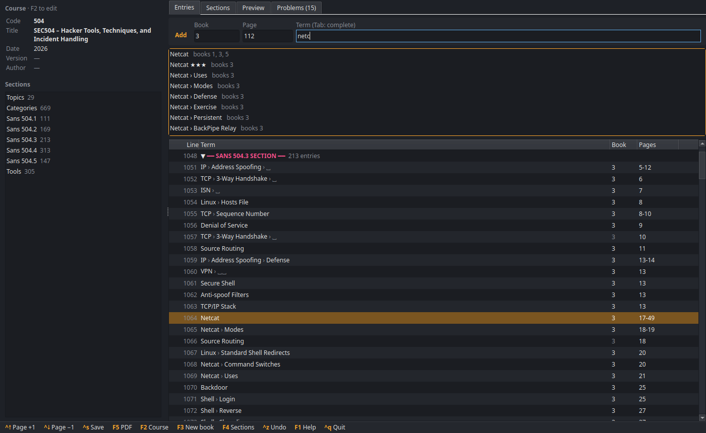

??? note "In the terminal (`--tui`)"

    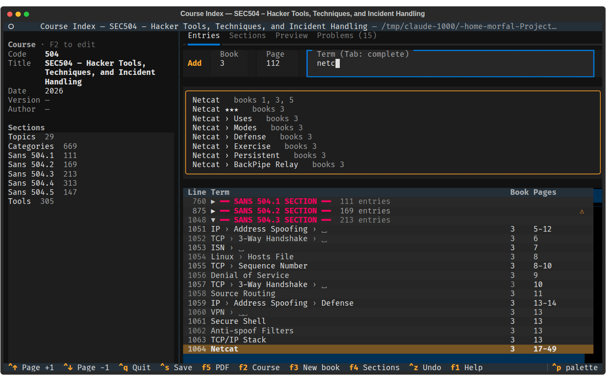

Each line of the file is a row: entries with their levels (`›`), book and pages, section headers in color, comment
blocks summarized. Blank lines are hidden.

Each section is a block of lines, **collapsed by default**: its header shows a caret (`▶` collapsed, `▼` expanded),
its number of entries and, when collapsed, a `⚠` or `✖` if it hides a problem. Selecting an entry (after adding it,
or from the *Problems*, the *Preview* or the sidebar) expands its section; the filter searches all the sections. The *Book* column shows the inherited book in grey for pages written
without `|book{N}`. A `⚠` or `✖` flags a problem (see the *Problems* tab), `%` a commented-out entry.

| Key | Action |
|---|---|
| `→`, `←` | expand / collapse the section (on its header or any of its lines) |
| `Enter`, `Space`, click on the caret | expand / collapse the section (on its header) |
| `+`, `-` | expand / collapse all the sections |
| `Enter`, `e`, double click | edit the entry |
| `n` | new entry after the current line (see below) |
| `a` | go to the quick-add bar (from any tab) |
| `c` | duplicate the entry |
| `d`, `Delete` | delete the line (section headers are protected) |
| `Space` | comment out / restore the entry (`%`) |
| `b` | insert a blank line after the group of the entry |
| `p` | insert a page break after the group of the entry |
| `x` | add a cross-reference (`alias \goto term`) in the CROSS-KEYS section |
| `Alt+↑`, `Alt+↓` | move the line up/down |
| `/`, `Ctrl+F` | filter |
| `Home`, `End`, `PageUp`, `PageDown` | navigate |

New entries always go to the block of their book: `n` inserts after the current line only if it is in the section of
the entry's book (or in the *Topics*/*Categories* for a topic or a category), otherwise at the end of the right
section, as the quick-add bar does. Likewise, changing the book of an entry in the editor moves it to the section of
its new book. Entries without `|book{N}` (the next pages of a term) stay where they are.

### Filter

The filter keeps the entries matching all its words: plain words are searched in the raw line and in the rendered
text, `book:2` keeps the entries of book 2 and `page:45` those whose page (or range) includes 45. `Esc` clears it.

## The entry editor

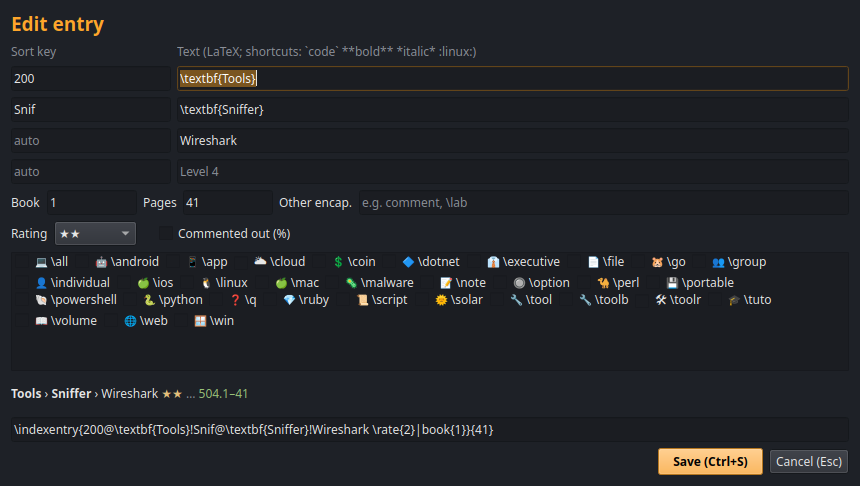

??? note "In the terminal (`--tui`)"

    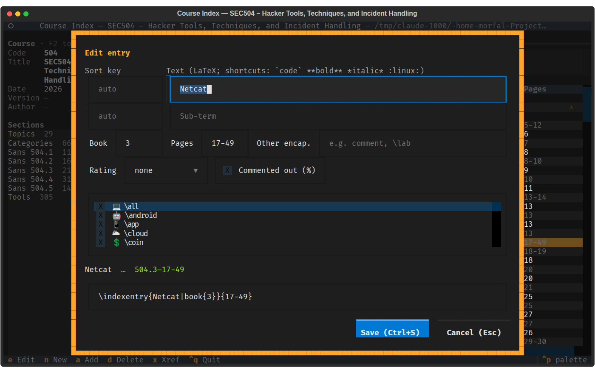

The editor shows the fields of an entry:

- up to four **levels**, each with an optional **sort key** (`key@text`);
- the **book**, the **pages** and any **other encapsulator** (e.g. `\lab` after `book{4}`, or `comment`);
  the book and the pages follow the same rules as in the quick-add bar (an existing book, no page 0, a range ending
  after it starts), except that a page read from the file is accepted as long as it is not changed;
- the **rating** (`\rate{n}`, shown as stars) and the **icons** (`\linux`, `\win`, ...) of the last level;
- whether the entry is **commented out**.

Below, a preview shows how the line is rendered (with its page number, e.g. `504.2–45`) and warns about unknown
commands. The raw `\indexentry` line can be edited directly: the fields follow, and vice versa. `Ctrl+S` or `Enter`
saves, `Esc` cancels.

A malformed `\indexentry` line (unbalanced braces, missing page, ...) opens in the editor too, to be corrected: the
raw line shows it as it is in the file, and the fields are filled with a best-effort reading of it (e.g.
`\indexentry{A useful{ reference|book{2}}{72}` gives the term `A useful{ reference`, book 2 and page 72). The preview
says what is wrong, and the line cannot be saved until it is well-formed; once saved, it is a normal entry again.

On the parts of a book in the *Topics*, the first level (its sort key and its bold text) is the
[title of the book](#titles-of-the-books): it is locked, in the fields as in the raw line, and edited in the *Sections*
tab, so that all the parts keep the same title.

## Preview

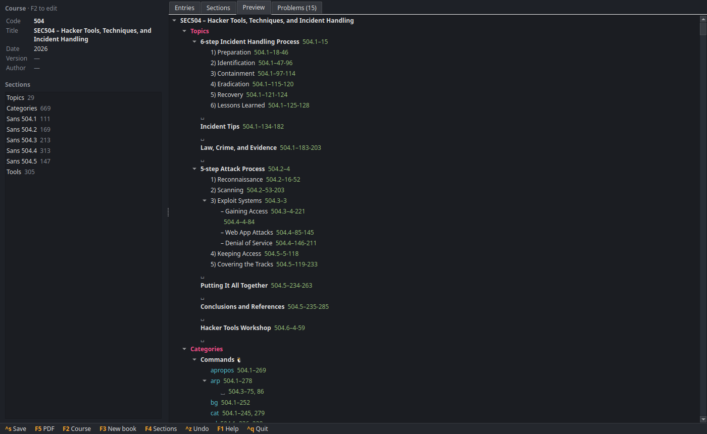

??? note "In the terminal (`--tui`)"

    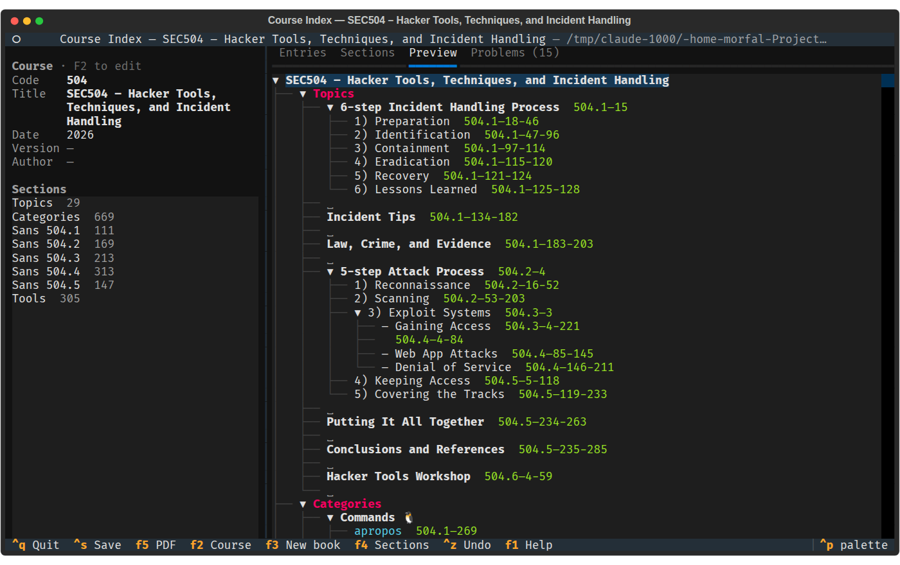

The *Preview* tab shows the index as makeindex sorts it, in the sections of the PDF (*Topics*, *Categories*, then
the letters), with the page numbers as the template prints them. Selecting a line jumps to its entry.

## Problems

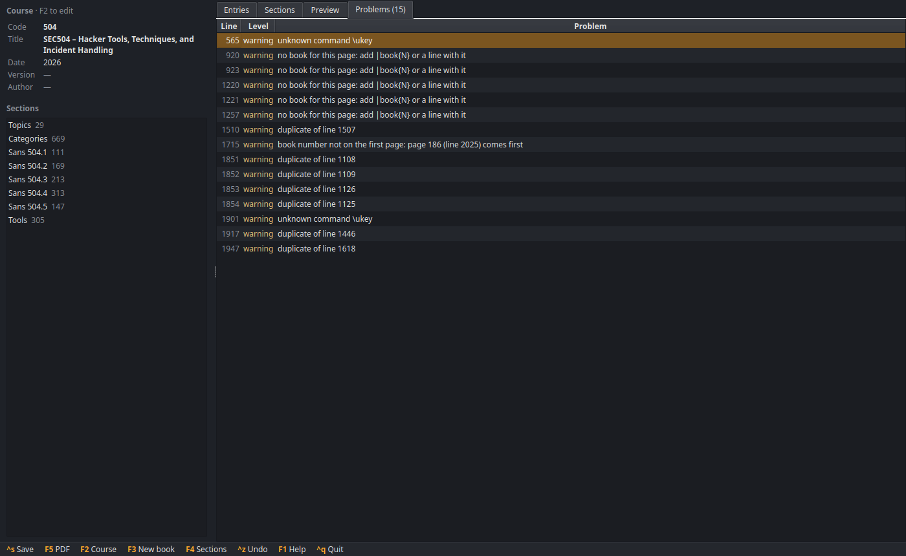

??? note "In the terminal (`--tui`)"

    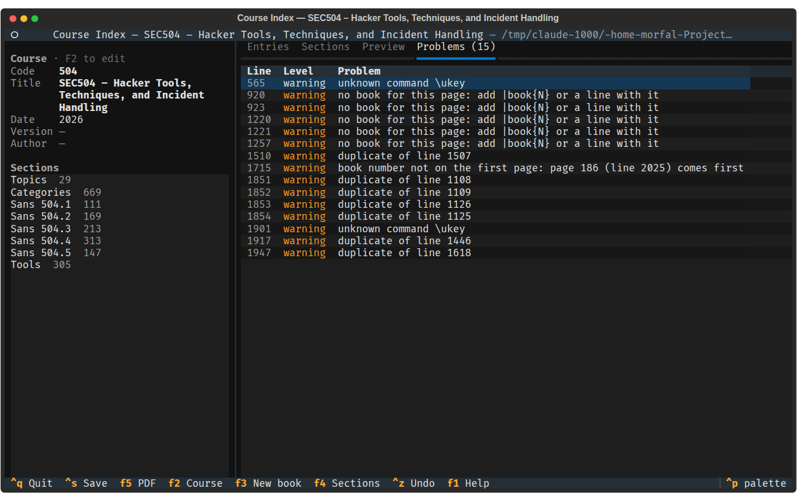

The index is checked in the background after each change:

| Problem | Why it matters |
|---|---|
| no book for this page | a page without `\|book{N}` whose term has no line with a book: the page is printed without book |
| book number not on the first page | makeindex sorts the pages: the page with `\|book{N}` must be the lowest |
| duplicate | same term, book and page twice |
| page | a page that is not a number or a range, page 0, or a range that does not end after it starts |
| starts with a command but has no sort key | it would be sorted in *Topics* instead of its letter |
| unknown command | the command is not defined by the template's `main.tex`, LaTeX would fail |
| malformed `\indexentry` | unbalanced braces, makeindex would reject the line; `Enter` on it opens the editor to correct it |

Selecting a problem jumps to its line.

## Sections and books

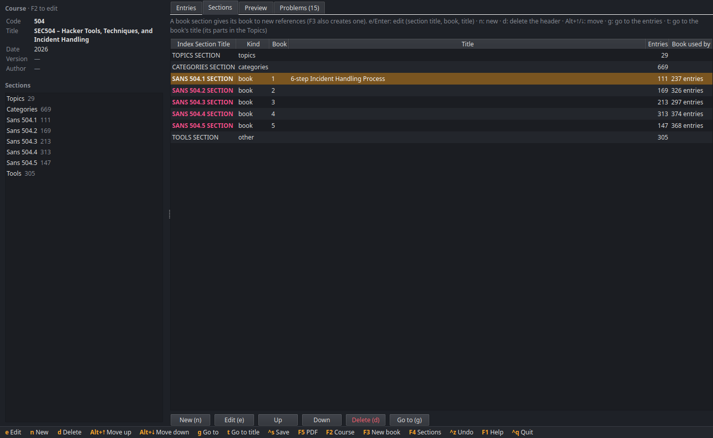

??? note "In the terminal (`--tui`)"

    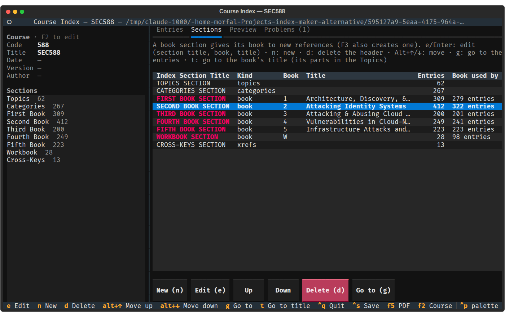

The *Sections* tab (`F4` goes to it) lists the sections of the file, with their kind (*topics*, *categories*, *book*, *xrefs* or
*other*), their book, the title of the book, the number of entries they hold and the number of entries using their
book. `e` on a section of the sidebar edits it directly.

| Key | Action |
|---|---|
| `Enter`, `e` | edit the index section title, the book and the title of the book (focused first) |
| `n` | new section after the current one (e.g. `LABS`, or a book) |
| `d` | delete the header (its entries then belong to the previous section) |
| `Alt+↑`, `Alt+↓` | move the section, with its entries, before the previous one or after the next one |
| `g` | go to the section in the *Entries* tab |
| `t` | go to the title of the book (its parts in the *Topics*) in the *Entries* tab |

The same actions are available as buttons under the list.

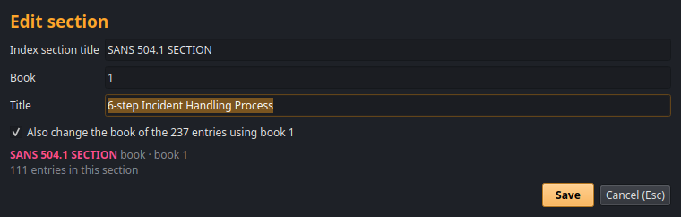

??? note "In the terminal (`--tui`)"

    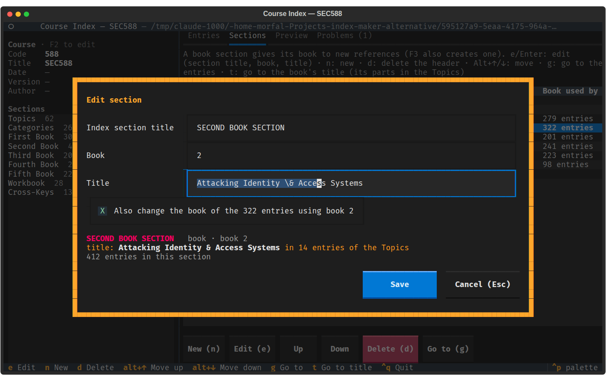

A section is a book section when its title says so: `FIRST BOOK SECTION`, `SANS 504.1 SECTION`, `BOOK 3 SECTION`,
`WORKBOOK SECTION` or any title with `(BOOK n)`. In the editor, the **Book** field sets it: the title follows
(`FIRST BOOK SECTION` → `SECOND BOOK SECTION`, `SANS 504.1` → `SANS 504.2`, `INTRODUCTION` →
`INTRODUCTION (BOOK 1)`), and clearing the field makes it a plain section (if its title does not name a book). When the
book changes, **Also change the book of the entries** (checked by default) renumbers `|book{old}` to `|book{new}` in
all the entries using the old book, e.g. to fix a book numbering or insert a book. Two sections cannot have the same
book, and the *Topics*, *Categories* and *Cross-keys* sections cannot be books.

### Titles of the books

The *Topics* section usually holds the outline of the course: for each book, a group listing its parts, whose bold first
level is the title of the book:

```latex
\indexentry{1a@\textbf{Learning Objectives}|book{1}}{8}
\indexentry{2a@\textbf{Strategic Planning Foundations}!1@Overview|book{1}}{6-22}
\indexentry{2a@\textbf{Strategic Planning Foundations}!2@Decipher the Business|book{1}}{36-37}
```

The group of a book's parts is the one with sub-entries whose references are all in this book (here
*Strategic Planning Foundations*; a single line such as *Learning Objectives* is not one, nor a group spanning several
books). Its bold title shows in the *Title* column, next to the book's section, whose own title is in the *Index Section
Title* column. In the section editor, the **Title** field renames the `\textbf{...}` in all the entries of the group,
keeping their sort key (`2a`). Write it in LaTeX, as in the entries (`\&`, and `"!`, `"@`, `"|` for these characters).
This is the only place to change it: the entry editor locks the first level of these entries.

`t` on a book section goes to the parts of the book in the *Entries* tab, and `s` on one of these lines goes back to the
book's section in the *Sections* tab (on any other line, `s` shows the section holding it).

Titles are written in uppercase and end with `SECTION`. A header that also holds comments (such as the *Topics* and
*Categories* headers of the template) cannot be deleted, only renamed. Every change can be undone with `Ctrl+Z`.

## Course metadata

`F2` edits the course **code** (the prefix of the page numbers, e.g. `504` in `504.2–45`), **title**, **date**,
**version** and **author**. They are saved in the template's `data.tex` next to the index, or in `<name>.data.tex`
when it exists (useful when a folder holds several indexes, such as `sec504.idx` and `sec504.data.tex`). The sidebar
shows them, rendered from their LaTeX, with a dash for an empty one.

## Saving and compiling

- `Ctrl+S` saves the index. The first save of a session keeps a copy of the original file as `<name>.idx.bak`.
- `F5` saves and compiles the PDF (`<name>.pdf` next to the index), then opens it. Errors and warnings of makeindex
  and pdflatex are reported; LaTeX errors do not prevent the PDF from being produced (like Texmaker's quick build).
- `Ctrl+Q` quits, asking whether to save the changes.

When the folder of the index holds `main.tex` and `lib/std.ist` (a copy of the template, possibly customized), they
are used for compiling; otherwise the template bundled with Course Index is used.

The PDF is built in a temporary folder, where LaTeX also finds the files of the index's folder: an image referenced
as `img/diagram.png` (in an entry, `main.tex` or `data.tex`) is taken from the `img` folder next to the index. The
report of the compilation shows the commands that were run, followed by their logs.
